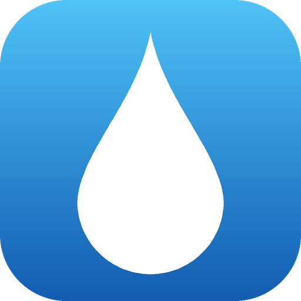
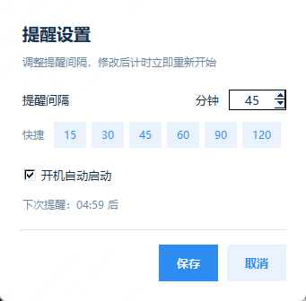

<div align="center">
  
  <h1>喝水提醒小助手</h1>
  <p><b>Water Reminder</b> · 常驻 Windows 系统托盘的喝水提醒工具</p>
  <p>单文件 exe · 免安装 · 免运行库 · 无需管理员权限</p>
</div>

---

## 功能特性

- **定时提醒** — 间隔 1~240 分钟可调，默认 45 分钟，配置自动持久化。以「下次触发的绝对时刻」计时，系统休眠唤醒后立刻按真实经过时间判断，不会多等一个间隔
- **免打扰** — 可配置免打扰时段（支持跨午夜）、托盘一键暂停 1 / 4 小时、全屏应用 / 演示时延后提醒；免打扰期间计时暂停，恢复后重新给一个完整间隔
- **右下角置顶弹窗** — 自动定位到主屏工作区右下角（避开任务栏），圆角 + 淡入动画 + 可拖动，附一声轻提示音
- **一键交互** — 弹窗内「已喝水」按设定间隔重置计时；「5 分钟后再提醒」延后提醒；右上角 ✕ 等同延后
- **系统托盘常驻** — 右键菜单：立即提醒 / 免打扰子菜单 / 设置… / 开机自启开关 / 退出；悬停显示剩余时间或当前免打扰原因
- **开机自启** — 写 `HKCU\Software\Microsoft\Windows\CurrentVersion\Run` 注册表项，**无需管理员权限**，托盘菜单一键开关
- **单实例运行** — 重复启动会自动忽略，不会堆出多个托盘图标
- **异常自留痕** — 启动期、主线程 tick、Tk 回调、托盘回调、配置读写的异常堆栈统一写入 `%APPDATA%\WaterReminder\error.log`

## 界面预览

### 提醒弹窗


### 设置窗口



> 上面这张是改版前的设置窗截图。当前版本在「开机自动启动」下方多了一整块 **免打扰** 配置区（时段开关、起止时间、全屏选项、暂停状态提示），其余布局一致。

## 快速开始

> **本仓库暂不提供预编译好的 exe**（`dist/` 已被 `.gitignore` 忽略），请按下面的方式自行打包或直接运行源码。
> 另外注意：程序运行后**不会弹出主窗口**，而是静默驻留系统托盘（首次运行会弹一个气泡说明）。
> 如果托盘区看不到水滴图标，点任务栏右下角的 `^` 展开隐藏图标区域，把图标拖到常显区即可。

### 方式一：打包成 exe（推荐）

```bash
cd WaterReminder
pip install pystray pillow pyinstaller
python make_icon.py
pyinstaller --noconfirm --clean --onefile --windowed ^
    --name WaterReminder --icon water.ico ^
    --hidden-import pystray._win32 main.py
```

产物在 `dist\WaterReminder.exe`，单文件约 18 MB。拷到任意 Windows 机器上双击即可运行，无需安装 Python 或任何运行库。

也可以直接双击 `build.bat` 一键完成上述所有步骤。脚本无需预先配置：首次运行会自动创建虚拟环境 `.venv311` 并安装 `requirements.txt` 里的依赖，前提只是系统里装有 Python 3.9+（找不到时会提示安装命令）。

> exe 未做代码签名，首次运行时 Windows SmartScreen 可能提示"未知发布者"，点「更多信息」→「仍要运行」即可。

### 方式二：从源码直接运行

```bash
# 需要 Python 3.9+（Windows 版，且必须带 tkinter）
cd WaterReminder
pip install pystray pillow
python main.py
```

## 使用说明

| 想做的事 | 怎么操作 |
| --- | --- |
| 现在就想被提醒 | 托盘图标右键 → 立即提醒（不受免打扰限制） |
| 改提醒间隔 | 托盘图标右键 → 设置… → 填 1~240 → 保存（也可点 15/30/45/60/90/120 快捷值） |
| 临时重新计时 | 弹窗里点「已喝水」 |
| 再拖一会儿 | 弹窗里点「5 分钟后再提醒」，或右上角 ✕ |
| 看还剩多久 | 鼠标悬停在托盘图标上 |
| 临时不被打扰 | 托盘图标右键 → 免打扰 → 暂停 1 小时 / 暂停 4 小时 |
| 提前恢复提醒 | 托盘图标右键 → 免打扰 → 恢复提醒 |
| 固定时段免打扰 | 设置… → 免打扰 → 勾选「启用免打扰时段」并填起止时间 |
| 开会 / 演示不弹窗 | 设置… → 免打扰 → 勾选「全屏应用 / 演示时延后提醒」（默认开启） |
| 开机自动启动 | 托盘图标右键 → 开机自启（勾选即开启） |
| 彻底退出 | 托盘图标右键 → 退出 |

## 免打扰

三种条件任一命中，就不弹提醒，托盘提示会显示当前原因（如「免打扰时段 22:00–08:00」「全屏应用中，暂不打扰」「已暂停提醒（还剩 37 分钟）」）：

| 条件 | 默认值 | 在哪里设置 |
| --- | --- | --- |
| 免打扰时段 | 关闭；默认时段 `22:00 – 08:00` | 设置… → 免打扰 |
| 一键暂停 | 无 | 托盘 → 免打扰 → 暂停 1 / 4 小时 |
| 全屏应用 / 演示 | 开启 | 设置… → 免打扰 |

行为约定：

- **时段支持跨午夜**，如 `22:00 – 08:00` 表示晚 10 点到次日早 8 点；`09:00 – 18:00` 则是白天时段。起止时间填成一样视为不启用该时段。时间按本机本地时间判定，格式 `HH:MM`（填 `9:5` 会自动规范成 `09:05`，非法值保留原设置）。
- **免打扰期间计时暂停**，剩余时间冻结；状态解除时重新给一个完整间隔，不会一解除就连着弹好几次。
- **一键暂停会写入配置文件**，程序重启后只要还没到点就继续生效；到点自动清除。暂停期间在设置窗点「保存」不会解除暂停，需用托盘菜单的「恢复提醒」。
- **全屏判定**：前台窗口铺满主屏、且不是桌面 / 任务栏等 shell 窗口。看视频、打游戏、PPT 全屏放映时不会顶一个弹窗出来，切回桌面后继续计时。
- **「立即提醒」是手动动作**，会绕过所有免打扰条件，方便随时确认弹窗效果。

## 数据与自启

| 项目 | 位置 |
| --- | --- |
| 配置文件 | `%APPDATA%\WaterReminder\config.json` |
| 错误日志 | `%APPDATA%\WaterReminder\error.log` |
| 开机自启注册表项 | `HKCU\Software\Microsoft\Windows\CurrentVersion\Run` → 值名 `WaterReminder` |

`config.json` 采用白名单读取，只认下面这些字段，读入时会做范围校验和规范化；写入走「临时文件 + `os.replace()`」原子替换，避免断电留下半截 JSON。

| 字段 | 含义 | 默认值 |
| --- | --- | --- |
| `interval` | 提醒间隔（分钟，1~240） | `45` |
| `welcomed` | 是否已弹过首次运行气泡 | `false` |
| `dnd_enabled` | 是否启用免打扰时段 | `false` |
| `dnd_start` / `dnd_end` | 免打扰起止时间 | `"22:00"` / `"08:00"` |
| `dnd_fullscreen` | 全屏应用时延后提醒 | `true` |
| `pause_until` | 一键暂停的到期时间戳（0 表示未暂停） | `0.0` |

卸载时删掉 exe、上面两个文件，再把注册表里那项删掉即可，不留残留。

## 技术实现

- **GUI**：Python 标准库 `tkinter`。弹窗用 `overrideredirect` 去掉系统边框 + `-topmost` 始终置顶，
  通过 `SystemParametersInfoW(SPI_GETWORKAREA)` 取工作区尺寸完成右下角定位，
  再用 `CreateRoundRectRgn` + `SetWindowRgn` 切圆角、`-alpha` 做淡入动画。
- **系统托盘**：`pystray`（Windows 后端直接调 `Shell_NotifyIcon`）。
- **线程模型**：tkinter 事件循环跑在主线程；pystray 的托盘消息循环跑在子线程。
  托盘菜单回调发生在托盘线程，禁止直接操作 Tk，统一通过 `queue` 回投主线程（80ms 轮询）执行。
- **计时**：只保存 `next_fire_at`（`time.time()` 墙钟绝对时刻），`remaining` 是从当前时间算出的显示值。
  主线程的 `after(1000, ...)` 每秒只负责「算剩余 + 判断是否触发 + 刷新 UI」，不推进状态；
  整段逻辑包在 `try/finally` 里，无论刷新是否抛异常都会把下一拍重新挂上，计时器不会因一次异常永久停摆。
  用墙钟而非单调时钟，是因为 Windows 睡眠期间 RTC 继续走，唤醒后能立刻算出「已经超时」。
- **容错**：配置原子写 + 字段白名单校验；`root.report_callback_exception` 接管 Tk 回调异常，
  连同启动期、tick、托盘回调、配置读写的异常一起落到 `error.log`（`--windowed` 下 stderr 不可见，这一步是必需的）。
- **单实例**：`CreateMutexW` 命名互斥体，用 `WinDLL(use_last_error=True)` + `ctypes.get_last_error()`
  读取 `ERROR_ALREADY_EXISTS`，避免 `GetLastError()` 被 Python 层其它 Win32 调用覆盖；句柄保存在模块级防止被回收。
- **免打扰**：每秒由 `_dnd_state()` 汇总手动暂停、时间窗口、前台全屏三个条件；
  全屏判定走 `GetForegroundWindow` + `GetWindowRect` + `GetClassNameW`，并排除桌面 / 任务栏类名。
- **图标**：不依赖外部图片资源，`Pillow` 在启动时按贝塞尔曲线实时绘制水滴图标
  （这样托盘图标和 exe 图标同源，改一处即可）。
- **DPI 感知**：`shcore.SetProcessDpiAwareness(1)` 配合 `tk scaling = dpi / 72`，
  让窗口在 125% / 150% 缩放的屏幕上不发虚。
- **打包**：PyInstaller `--onefile --windowed`，产物约 18 MB。

## 项目结构

```
WaterReminder/
├── main.py                  # 主程序（GUI + 托盘 + 计时 + 免打扰 + 注册表）
├── make_icon.py             # 调 main.py 的绘制函数生成 multi-size ico
├── build.bat                # 一键打包脚本（自动创建虚拟环境并装依赖）
├── requirements.txt         # 运行/打包依赖
├── water.ico                # 应用图标（由 make_icon.py 生成）
├── test_smoke.py            # 冒烟测试：跑通弹窗/设置/注册表/计时，并截图核对
├── test_exe.py              # 端到端测试：真跑 exe，验证定时弹窗真的会出现
├── shot_readme.py           # 生成 README 配图
└── docs/                    # README 图片资源
```

## 环境要求

- Windows 10 / 11（x64）
- 使用 exe：无任何额外依赖
- 自行打包：Python 3.9+（同下），双击 `build.bat` 即可，脚本自动创建虚拟环境并安装依赖
- 从源码运行：Python 3.9+，且该 Python 必须包含 tkinter
  （python.org 官方安装包默认带；Microsoft Store 版和部分精简版可能没有）

## 常见问题

**双击后什么都没发生？**
正常的。程序常驻托盘，不显示主窗口。看任务栏右下角的 `^` 展开区域。
也有可能是已有实例在运行——单实例机制会让重复启动静默退出，先检查任务管理器里有没有 `WaterReminder.exe`。

**一直不提醒，是不是坏了？**
先看托盘悬停提示：如果显示「免打扰时段…」「已暂停提醒…」「全屏应用中…」，说明是免打扰在生效。
托盘 → 免打扰 → 恢复提醒，或到设置里关掉对应选项。都没有的话看 `%APPDATA%\WaterReminder\error.log`。

**睡醒之后立刻弹窗 / 或者过了很久才弹？**
计时按绝对时刻判断：睡眠期间系统时钟继续走，唤醒后若已过触发时刻会立即提醒，这是预期行为。
弹窗没被点掉之前计时保持冻结，点「已喝水」或「5 分钟后再提醒」后重新计时。

**开机自启勾了没用？**
自启记录的是 exe 的绝对路径。如果你把 exe 挪到别处，需要重新勾一次。

**托盘图标不见了？**
程序在跑但图标被系统折叠了，点 `^` 展开；如果进程真的没了，看 `%APPDATA%\WaterReminder\error.log`。

**弹窗挡住了别的窗口？**
弹窗是置顶的，鼠标按住它能拖到别处，或者直接点 ✕ 让它 5 分钟后再来。
开会 / 演示时可以在设置里开启「全屏应用 / 演示时延后提醒」。

## 近期改动

- 计时从「每秒递减计数」改成「绝对触发时刻」，修掉休眠唤醒后要多等一整个间隔、以及主线程卡顿导致漂移的问题。
- `_tick` 用 `try/finally` 保护 `after` 回调链；接管 Tk 回调异常，所有异常统一落 `error.log`。
- 配置改为原子写 + 字段白名单校验，损坏的 JSON 会回退默认值并留痕，不再静默丢失设置。
- 单实例互斥体改用 `use_last_error` 并把句柄提到模块级。
- 新增免打扰：时段（含跨午夜）、一键暂停、全屏检测，以及配套的托盘子菜单和设置窗配置区。
- 托盘一次性提示（如「好样的！」）加了短暂压制，不会被下一拍倒计时立刻盖掉。
